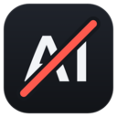
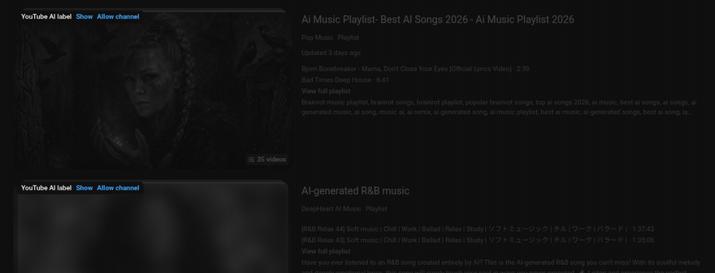
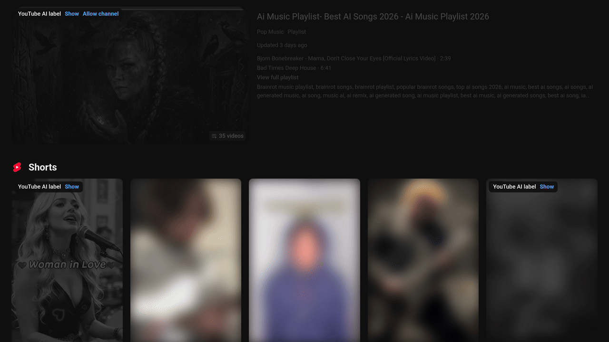
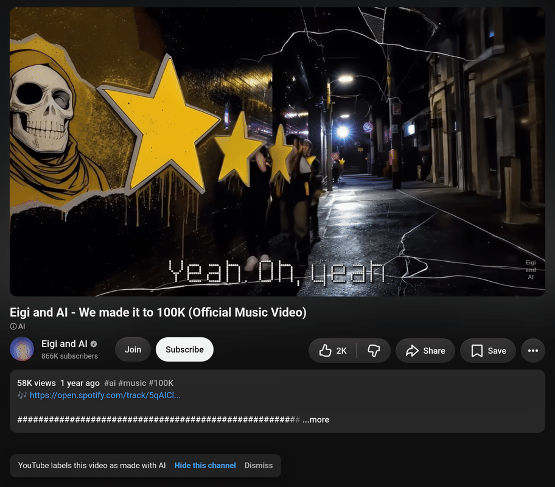
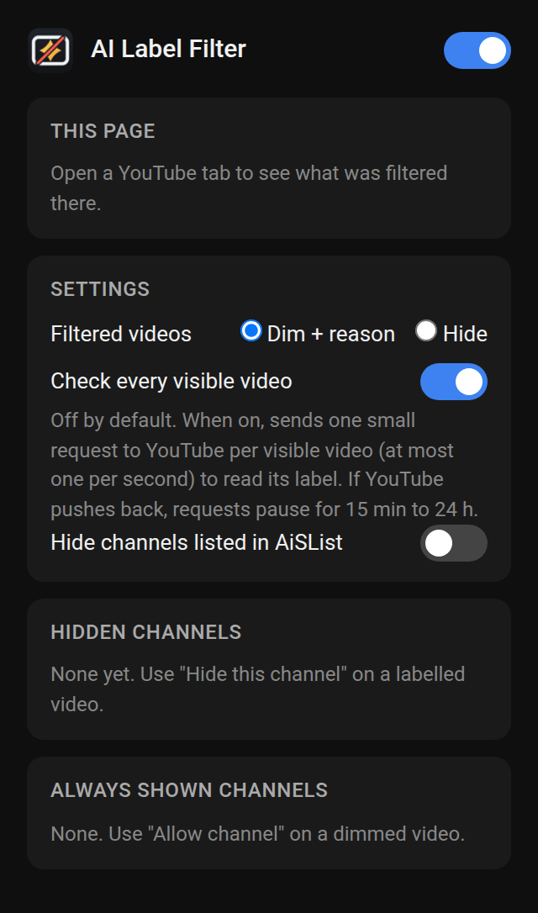

# AI Label Filter for YouTube

A Chrome extension that dims or hides videos YouTube labels as made with AI and shows why they were filtered. It does not guess, use a server, or require an account.

[한국어](README.kr.md)

Download the zip from [Releases](https://github.com/Nova-47/ai-label-filter-for-youtube/releases) and load it in Chrome ([steps](#install)). It is not in the Chrome Web Store. [Try it in 60 seconds](#try-it-in-60-seconds).

> It catches only videos YouTube labels, and most AI videos are not labelled. For more coverage, turn on the community list AiSList or "Check every visible video" (both are off by default).

A video counts as AI only if YouTube shows its AI badge under the title. It uses no model, title heuristic, or thumbnail heuristic. Filtered cards are dimmed by default and show a chip with the reason, **Show**, and, when the card links its channel, **Allow channel**. Select **Hide** in the popup to remove them.

There is no server, dependency, or build step. The extension requires `storage` and a content script on www.youtube.com. Every network request is made in one of two functions, listed [below](#how-to-audit-it).

---

## Install

1. Download `ai-label-filter-for-youtube-<version>.zip` from [Releases](https://github.com/Nova-47/ai-label-filter-for-youtube/releases) and unzip it into a folder. (Or clone the repository: it loads as is, there is nothing to build.)
2. Open `chrome://extensions` and turn on **Developer mode** (top right).
3. Click **Load unpacked** and select the folder.

Requires Chrome 110 or later.

## Try it in 60 seconds

By default, feeds change only for videos the extension already knows about, so a fresh install shows nothing. To test it:

1. Open [this video](https://www.youtube.com/watch?v=yHG-pivADos), which YouTube labels as made with AI. After a few seconds a banner appears in the bottom-left corner: "YouTube labels this video as made with AI", with **Hide this channel** and **Dismiss**.
2. Go to the channel's page (@eigi_and_ai) or search for the video. Wherever its card appears, it is now dimmed with the chip "YouTube AI label", because the result is saved on your device.
3. To filter feeds more widely, open the popup and turn on **Hide channels listed in AiSList** (a community list of about 29,000 channels; Chrome asks for permission to download it) or **Check every visible video** (asks YouTube about each video on screen, one request at a time).

---

## How it decides

### The signal

YouTube shows an "AI" badge under the title of videos it labels as made with AI. The badge is in the data YouTube's web app loads for a watch page, but not in the data for home, search or sidebar cards. To check a video's label, the extension sends one small request to `/youtubei/v1/next`, the endpoint the web app uses to load a watch page.

A video counts as AI only if the reply contains that badge: a `metadataBadgeRenderer` with style `BADGE_STYLE_TYPE_SIMPLE` and icon `INFO`. Auto-dubbed videos get a badge with the same style but a different icon, and do not count. The icon is checked, not the badge text, so YouTube's interface language does not matter.

### Where it checks

| Where | Requests | What happens |
|---|---|---|
| Watch page (`/watch?v=…`) | 1 for the video you opened, unless its result is already saved | If the video is labelled, a banner offers **Hide this channel** and **Dismiss**. |
| Feeds (default) | none | Cards are filtered only from what is already on your device: saved results, your channel lists, channels where most checked videos are labelled, and AiSList if it is on. |
| Feeds with **Check every visible video** on | 1 per card on screen that has no saved result | Labelled videos are filtered as they are found. |

Cards are recognised on home, subscriptions, search, channel pages, playlists, the watch-page sidebar and Shorts shelves.

### Why a card is filtered

In this order:

1. **Always shown channels**: a channel on this list is never filtered.
2. **Hidden channels**: you added the channel with **Hide this channel**. Chip: "Your blocklist".
3. **YouTube AI label**: the video itself is labelled. Chip: "YouTube AI label".
4. **Channel where most checked videos are labelled**: of the different videos from this channel checked on your device, at least 2 are labelled and at least 60% are labelled. A video checked again counts once. Chip: "Channel: N of M checked videos labelled". These cards are always dimmed with their reason, never hidden, even in Hide mode, because this is an inference rather than a label on the video.
5. **Listed in AiSList**: only if you turned AiSList on. Chip: "Listed in AiSList".

Cards that match no rule are shown. Rules 1, 2, 4 and 5 need a channel link on the card (a `/@handle` or `/channel/UC…` link).

Results are saved for 30 days for a video without the label (YouTube may add one later) and 180 days for a labelled one.

### What you see

- **Dim + reason** (default): the card is faded and a chip shows the reason, with **Show** (shows that video normally in this tab until you reload) and **Allow channel** (adds the channel to Always shown channels; only offered when the card has a channel link).
- **Hide**: filtered cards are removed from view, except cards filtered only because most checked videos of their channel are labelled, which stay dimmed. To see what was hidden, open the popup and press **Reveal** under "This page": that tab switches to the dimmed view, with the same chips, until you press **Hide again** or reload.
- **Watch page banner**: shown when the open video is labelled, in either mode. **Hide this channel** adds the channel to Hidden channels (the button is left out if the channel is unknown or already on that list). No banner appears for a channel on Always shown channels. The video itself is never hidden.

If anything fails (network error, timeout, unexpected reply, removed video), the video is shown and nothing is saved.

---

## Requests to YouTube

The watch page, card checks and the daily self-check all send the same request, from the youtube.com page itself (the content script):

- `POST https://www.youtube.com/youtubei/v1/next?prettyPrint=false&fields=<mask>`
- Body: `{"context":{"client":{"clientName":"WEB","clientVersion":"…","hl":"en","gl":"US"}},"videoId":"…"}`. Only the video ID changes. The client version is read from the YouTube page; until it is found there, a fixed recent version is sent.
- Your cookies are left out (`credentials: 'omit'`), so the request is not tied to your YouTube or Google account, and YouTube answers as it would a logged-out visitor.
- The field mask asks for two things only: the badges under the title, and the channel's ID and @handle. The reply is about 0.4 KB instead of about 400 KB.
- **One at a time, browser-wide.** All youtube.com tabs share one lock, and each request starts at least 1 second after the previous reply. Card checks add a random 0–1 s on top.
- Each request times out after 10 seconds.
- There is no retry without the mask.

When YouTube does not answer normally, requests pause in every tab:

| Reply | What happens |
|---|---|
| HTTP 403 or 429, any redirect, or an HTML "unusual traffic" / CAPTCHA / "Sorry" page | All requests to YouTube stop for 24 hours. The popup says "YouTube pushed back (…), so all requests are paused until …". |
| HTTP 400, 404 or 5xx, or a reply that is not JSON | All requests to YouTube pause for 15 minutes. If it keeps happening, the pause doubles each time (30 min, 1 h, …) up to 24 hours. One good reply ends it. The popup says "YouTube refused a request (…), so requests are paused until …". |

While requests are paused, cards are still filtered from what is already saved.

With default settings the extension sends one request per watch page whose result is not saved yet, plus the self-check's one or two requests a day.

### Daily self-check

Once every 24 hours per browser (not per tab), when a YouTube page loads or you navigate, the extension asks about two videos that carried the label on 2026-10-13: `yHG-pivADos` (@eigi_and_ai) and, only if the first does not show the label, `Xpg-JIuJ_cU` (@foreverharmony_official). It runs even when "Check every visible video" is off, so it normally sends one or two requests a day. It does not run while filtering is off or requests are paused; if requests are paused before it has sent anything, it runs once they are allowed again. If the page closes or reloads before the check finishes, it runs again on a page opened 5 minutes or more later. Its results are not saved and do not count towards channel flags.

| Result | Popup |
|---|---|
| A canary shows the label | nothing |
| The label can't be read: both canaries are there and neither is labelled, a canary's channel can be read but its label can't, or neither canary can be read at all (what a changed YouTube reply looks like) | "Label detection may be broken (YouTube may have changed something)." |
| YouTube refuses the check (HTTP 400, 404, 5xx or not JSON) | "YouTube refused the daily label check, so labels may not be read right now." The warning goes away on the next good reply from YouTube. |
| One canary is gone (removed or private) and the other is not labelled | nothing |
| Offline, or requests are blocked | nothing (a block shows its own message) |

---

## Privacy

There is no server, and nothing is sent to the developer. These are the extension's only requests:

| When | Request | Sent to | Contains | Your cookies |
|---|---|---|---|---|
| You open a watch page whose result is not saved | 1 × `POST /youtubei/v1/next` (field-masked) | `www.youtube.com` | the video ID and the client fields above | not sent |
| **Check every visible video** is on | the same, per card on screen with no saved result | `www.youtube.com` | that video's ID | not sent |
| Once a day (self-check) | the same, for one or two fixed videos | `www.youtube.com` | those videos' IDs | not sent |
| AiSList is on: at most once per 24 h, and when you turn it on or press **Refresh now** | `GET` of the [AiSList blocklist file](https://github.com/Override92/AiSList) | `raw.githubusercontent.com` | an ordinary file download; the daily check sends the ETag of the copy it has, so an unchanged list is not downloaded again | not sent |

As with any web request, YouTube and GitHub see your IP address and browser user agent.

Everything is stored in `chrome.storage.local` on your device. Nothing is stored in `chrome.storage.sync` or elsewhere:

- your settings
- Hidden channels and Always shown channels (channel ID and/or @handle, and when it was added)
- results per video: video ID, labelled or not, the day it was checked and the day its card was last seen; for labelled videos also the channel ID and @handle. At most 20,000 videos.
- per channel seen in a reply: its ID, its @handle, the IDs of up to 10 of its labelled and up to 10 of its unlabelled videos, and the day of its last result. At most 5,000 channels; past that, channels with fewer labelled videos and not seen for longer are dropped first, and dimmed channels or channels on your lists are always kept.
- if AiSList is on: the downloaded list and its download details (entry count, ETag, times, last error)
- whether requests are paused, until when and why, and when the last request was sent
- when the self-check last ran and its result

The number of filtered cards is not stored: the popup asks the open YouTube tab each time. Uninstalling the extension deletes all of it.

It uses no analytics, telemetry, YouTube Data API, or account. Full policy: [PRIVACY.md](PRIVACY.md).

---

## Permissions

| Permission | Why it is needed |
|---|---|
| `storage` | Keeps the data listed above on your device. |
| Content script on `*://www.youtube.com/*` | Reads video and channel links on YouTube pages, dims or hides cards, shows the watch-page banner, and sends the label request from the YouTube page itself. Because the request comes from `www.youtube.com`, no host permission is needed. |
| Optional: `https://raw.githubusercontent.com/*` | Asked for only when you turn AiSList on, and used only to download that list. Turning AiSList off gives the permission back. If you remove it in `chrome://extensions`, AiSList is turned off and its copy deleted. |

It does not ask for `tabs`, `history`, or "read and change all your data on all websites". The popup gets page counts from the YouTube tab's content script, so it does not need `tabs`.

---

## Settings (popup)

| Setting | Default | What it does |
|---|---|---|
| Switch in the header ("Turn filtering on or off") | On | Turns filtering, the banner and all requests to YouTube on or off. |
| Filtered videos: **Dim + reason** / **Hide** | Dim + reason | Dim fades the card and shows why; Hide removes it from view (see [What you see](#what-you-see)). |
| **Check every visible video** | Off | Asks YouTube about cards on screen that have no saved result: newest first, only while the tab is in front, each video once per tab. Cards scrolled away before their turn are skipped. |
| **Hide channels listed in AiSList** | Off | Filters channels on [AiSList](https://github.com/Override92/AiSList). Downloads the list at most once per 24 hours; **Refresh now** downloads it again. On first use the popup offers it in a "Community list (optional)" card with **Turn on** and **Not now**. |
| **Hidden channels** | empty | Channels added with **Hide this channel**. **Remove** takes one off. |
| **Always shown channels** | empty | Channels added with **Allow channel**. **Remove** takes one off. |

Adding a channel to one list takes it off the other. **Remove** removes the channel whether it was added by @handle or by channel ID.

The popup also shows how many cards were filtered on the open YouTube page for each reason, how many channels are dimmed because most of their checked videos are labelled, and a warning when requests are paused or the self-check found a problem.

---

## How to audit it

There are no dependencies, build steps, or minified code. The release zip contains the repository's extension files byte for byte; `scripts/package.sh` only selects and zips them. Network requests are made in `request()` in `content.js` (YouTube) or `doRefresh()` in `background.js` (AiSList, only if you turn it on). The decision rules, reply parsing, pauses, and self-check verdicts are functions in `shared.js`, tested with `node --test` without a browser.

## Known limitations

- **Label coverage is partial.** Most AI videos carry no YouTube label, and this extension does not guess.
- **Shorts and live pages are not checked.** On `/shorts/…` and `/live/…` pages no request is sent and no banner appears. Shorts cards in feeds are filtered like other cards.
- **Watch-page sidebar cards can't be matched to channel lists.** They have no channel link, so Hidden channels, Always shown channels, channel flags and AiSList don't apply there; only a known label does.
- **Playlist and mix cards are judged by their first video.** A card's link points to one video, so a whole playlist card can be filtered because of that video.
- **Incognito may have separate request limits.** If you allow the extension in incognito, incognito windows may use their own request queue, so their requests may not be spaced against those from normal windows.
- **The EU consent page is untested.** If YouTube answers a request with a redirect to it, requests pause for 24 hours like any redirect; if it answers with some other HTML page, they back off, starting at 15 minutes.
- **Channels can only be added to Hidden channels from the banner** of a labelled video. There is no way to type a channel in.
- **Only `www.youtube.com`.** `m.youtube.com` is not supported.
- **The endpoint is YouTube's internal one**, not a documented API. It can change or stop working at any time; then labelled videos are shown, not hidden.

---

## FAQ

**Why not use machine learning or heuristics?**
Guessing from titles, thumbnails or audio produces false positives, and then you can't tell why a video disappeared. This extension acts only on YouTube's label, your own channel lists, and (if you turn it on) a community list with its own review process. Every filtered card has a reason you can see and undo.

**Why does it need to talk to YouTube at all?**
YouTube doesn't include the AI label in the data for home, search or sidebar cards, only in a video's watch-page data. The request is sent from the YouTube page, because YouTube rejects it from an extension's background service worker.

**Can YouTube rate-limit or block me?**
There are no guarantees with an internal endpoint, and the requests come from your IP address. The extension keeps the rate low (see [Requests to YouTube](#requests-to-youtube)), leaves out your cookies, and stops when YouTube pushes back. If you want no requests from feeds, leave **Check every visible video** off (the default).

**A video that is obviously AI is still showing.**
Most likely it has no YouTube label. Turn on **Hide channels listed in AiSList** for broader coverage.

**AiSList filtered a channel that isn't AI.**
Use **Allow channel** on its card; the channel will not be filtered again. To get the entry fixed for everyone, use [AiSList's own removal process](https://github.com/Override92/AiSList). This extension does not edit the list.

---

## Development

- Tests: `node --test` (no dependencies). `tests/harness.js` runs `content.js` against a fake browser with a virtual clock.
- Zip for release: `scripts/package.sh` writes `dist/ai-label-filter-for-youtube-<version>.zip`.
- Debug log: set `DEBUG = true` at the top of `content.js`; messages start with `[AI Label Filter]`.

## Credits

- Reading YouTube's AI label with one field-masked `/youtubei/v1/next` request per video comes from [Weedout for YouTube](https://github.com/masteranza/weedout-for-youtube) (MIT). The card container list and the client version lookup in `content.js` are adapted from it; its MIT notice is in the header of `content.js`.
- [AiSList](https://github.com/Override92/AiSList) by Override92 is licensed under [CC BY-NC 4.0](https://creativecommons.org/licenses/by-nc/4.0/). It is not bundled with this extension; your browser downloads it from its source only if you turn it on. This extension is free and non-commercial, and is not affiliated with AiSList.

## Contributing

For major changes, open an issue first. Pull requests are welcome.

## License

[MIT](LICENSE)

This project is not affiliated with, endorsed by, or sponsored by YouTube or Google LLC. YouTube is a trademark of Google LLC.
